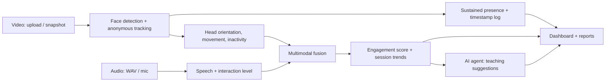

# 🎓 Multimodal Attendance & Engagement Agent

AI-powered, privacy-preserving classroom intelligence: **computer vision + audio signal processing + agent-based reasoning**
for automated attendance, engagement analytics and teaching suggestions. Built with Python and Streamlit.

## Features
- **Sustained-presence attendance**: a face must be seen continuously (default 30 s) to count, so passers-by and flickering detections do not create false positives. Timestamped log, editable names, CSV export.
- **Engagement analysis**: head orientation (frontal vs profile vs not visible) + movement + audio activity are fused per time window into class- and participant-level engagement.
- **Audio module**: loudness-based speech/silence detection from WAV upload or browser microphone (no transcription).
- **AI teaching suggestions**: the agent detects dips, fade-outs and lecture-heavy pacing and proposes assistive actions. Optional Gemini rewrite (aggregate numbers only).
- **Inactivity detection**: stillness of head position is tracked per window and shown on the dashboard.
- **Reports**: printable HTML session report, CSV exports, and an optional *Save to local folder* (`data/sessions/`) for local runs.
- **Demo mode** (no upload needed) and **live snapshot** from the browser camera, with a timestamped snapshot log.
- **Built-in self-check** (About tab): accuracy on a synthetic ground-truth session + pipeline timing.
- **Privacy**: no face recognition, no frames stored, uploaded video deleted after processing, core analysis works offline.

## Architecture & workflow


## Project structure
| File | Purpose | Epic |
|---|---|---|
| `requirements.txt`, `.streamlit/config.toml`, `README.md` | Setup & environment | 1 |
| `vision.py` | Face detection, anonymous tracking, head-orientation cue | 2 |
| `audio.py` | WAV decoding, speech-activity detection | 3 |
| `analytics.py` (fusion) + `recommender.py` | Multimodal fusion & agent reasoning | 4 |
| `analytics.py` (insights) + `recommender.py` | Analytics & recommendation engine | 5 |
| `app.py`, `report.py`, `evaluate.py`, `tests/`, deployment | Interface, reports, testing, deployment | 6 |

## Requirements
Python **3.9+** (Streamlit itself no longer supports 3.8), any modern browser, Git. Runs on a normal laptop
(i5 / 8 GB RAM) - CPU only, no GPU, and the core analysis needs no internet.

## Run locally
```bash
pip install -r requirements.txt
streamlit run app.py
pytest -q          # optional: run the tests
```

## Deploy on Streamlit Community Cloud
1. Push this folder to a **public GitHub repo** (`app.py` and `requirements.txt` at the repo root).
2. Go to <https://share.streamlit.io> -> **Create app** -> pick the repo, branch `main`, main file `app.py`.
3. Click **Deploy**. No `packages.txt` is needed (OpenCV headless only).
4. *(Optional)* In **Settings -> Secrets** add `GEMINI_API_KEY = "your-key"` to enable the Gemini wording.
5. Paste the app URL as the **Demo link** and the repo URL as the **GitHub link** on SkillWallet.

## Notes & limitations
- Head orientation is a coarse cue (frontal / profile / not visible), not a full yaw-pitch-roll head pose.
- "Live" input on Streamlit Cloud means browser snapshots (logged over time) and recorded uploads; true continuous webcam
  streaming would need `streamlit-webrtc` and a TURN server.
- Haar cascades are light and offline-friendly but best with front-facing cameras and good lighting.
- A person who leaves and re-enters may receive a new anonymous ID; the gap tolerance in `analytics.py` reduces this.
- Engagement is a decision-support signal, not a judgement of any individual.
